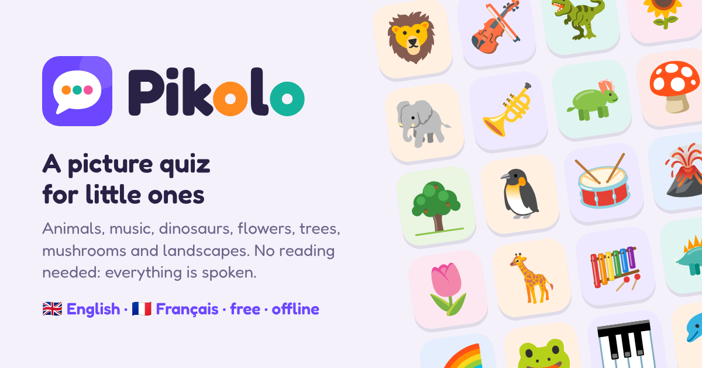

<p align="center"></p>

# Pikolo

**A picture quiz for little ones.** Children from about 3 years old learn the names of animals, musical instruments, dinosaurs, flowers, trees, mushrooms and landscapes, with pictures and sounds. No reading needed: everything is spoken, in English or French.

- 233 pictures in 7 topics, real instrument recordings, real animal recordings
- Free, no ads, no account, nothing collected
- Works on phones, tablets and computers, and offline once opened

**Play:** https://bachmannalexis.github.io/Quiz/ (see [Publishing](#publishing)), or download this repository and open `index.html`.

## How to play

Pick a topic, then a game:

- 🗣️ **Find the picture**: the voice asks "Where is the cello?" and the child taps the right picture among three. Its name then appears on the card.
- 👂 **Listening games** (music, animals, dinosaurs, landscapes): an instrument plays, the voice asks "Who says moo?" or "Who says roar?", or a place is heard (waves, wind, rain, birds, a city…), and the child finds the picture.
- 👆 **Discover**: tap any picture to hear its name, then its sound: the instrument's tune, the place's sounds, the animal's real call, or what the animal or dinosaur says. Flowers, trees and mushrooms make no sound, so they say their name (and the poisonous mushrooms add a warning). The pictures at the top of each topic page can be tapped too. In music, the instrument can be played on 8 rainbow keys (a pentatonic scale, so everything sounds nice).

A game has 10 rounds, shown as a progress bar; each first-try answer earns a star, and the best score is kept on the topic card. Pictures that look or sound alike (lion and tiger, trumpet and trombone, button mushroom and death cap) never appear together, and nothing repeats within a game. The **?** button opens a page for parents with how to play, sharing and privacy.

| Topic | Items | Groups |
|---|---|---|
| 🐄 Animals | 87, 22 of them with a real recording (cow, horse, rooster, owl, bee…) and 23 with what they say ("the cow says moo") | farm, wild, sea, birds, bugs |
| 🎻 Music | 55 instruments, each with a short tune in its style | orchestra, jazz, rock & pop, world |
| 🦖 Dinosaurs | 12 (with the mammoth, the plesiosaurus and a dinosaur egg), each with a sound ("the T. rex says roar") | |
| 🌻 Flowers | 22 | |
| 🌳 Trees | 19 | |
| 🍄 Mushrooms | 14 | |
| 🏔️ Landscapes | 24, 16 of them with real sounds (waves, stream, wind, birds, rain, thunder, bubbles, a city) | |

**Mushrooms, a note for parents:** the fly agaric and the death cap are marked ⚠️ and the voice says they are poisonous and must never be eaten. The game teaches names, not which mushrooms are safe to pick; never let children eat wild mushrooms.

### Instrument styles

| Style | Instruments |
|---|---|
| 🎻 Orchestra | violin, cello, double bass, harp, flute, clarinet, oboe, bassoon, French horn, trumpet, trombone, tuba, timpani, drum, bass drum, cymbals, xylophone, glockenspiel, bell, triangle, piano, pipe organ |
| 🎷 Jazz | saxophone, clarinet, trumpet, trombone, tuba, double bass, piano, drum kit, banjo, harmonica |
| 🎸 Rock & pop | electric guitar, bass guitar, guitar, drum kit, synthesizer, piano, harmonica, tambourine, cowbell |
| 🌍 World | accordion, bagpipes, sitar, koto, shamisen, ukulele, banjo, guitar, kalimba, steel drum, music box, pan flute, ocarina, recorder, whistle, djembe, bongos, taiko, tabla, maracas, tambourine, castanets, claves, guiro, wood block, cowbell, jingle bells |

Each instrument plays a short tune in its style, for example the opening of Bach's Cello Suite on the cello, a walking bass on the double bass, Bach's Toccata on the pipe organ, *Sakura* on the koto, *Amazing Grace* on the bagpipes and *Twinkle Twinkle* on the music box.


## Publishing

The workflow in `.github/workflows/pages.yml` publishes the app to GitHub Pages each time `main` changes. It needs a one-time setting: **Settings → Pages → Build and deployment → Source: GitHub Actions**. The app is then at https://bachmannalexis.github.io/Quiz/, and links shared in messaging apps show a preview card (`icons/og-image.png`). On the website the app can be added to the home screen and works offline (`manifest.webmanifest`, `sw.js`; bump `VERSION` in `sw.js` when files change).

## Project layout

| Path | What it is |
|---|---|
| `index.html` | The page: home, topic, game, end and play screens, parents' sheet |
| `app/app.js` | The app logic |
| `app/words.js` | Everything the app says and shows, in English and French |
| `app/voice/` | The recorded voice: every sentence in English and French (`<lang>/<topic>.json`, loaded when a topic opens) |
| `app/style.css`, `app/font.css` | Design (one bright theme; each topic recolors its screens) and the embedded Fredoka font |
| `app/topics.js` | Topics and items: names in English and French, families, groups, animal sounds |
| `app/pictures.js`, `app/sounds.js` | Generated pictures and sounds (sounds load only when music is opened) |
| `pictures/` | The pictures drawn for the app (SVG) |
| `icons/` | App icon, home-screen icons and the link preview image |
| `tools/` | Scripts that build `pictures.js`, `sounds.js` and the voice |

## Sounds and pictures

Everything is bundled in the page, so it works offline:

- `app/sounds.js`: for each instrument a short tune and the notes for the play mode, built by `tools/make_sounds.py`.
- `app/pictures.js`: all 233 pictures, built by `tools/make_pictures.py`.

Where each instrument's sound comes from, best first:

| Library | Instruments |
|---|---|
| [VSCO 2 Community Edition](https://github.com/sgossner/VSCO-2-CE), real orchestra recordings (via npm `tiny-orchestra`) | double bass, harp, flute, oboe, clarinet, bassoon, French horn, trumpet, trombone, tuba, timpani, glockenspiel, bass drum, drum, cymbals, triangle, claves, wood block |
| [Salamander Grand Piano](https://archive.org/details/SalamanderGrandPianoV3), a real Yamaha C5 grand (via npm `@audio-samples/piano-mp3-velocity10`) | piano |
| [tonejs-instruments](https://github.com/nbrosowsky/tonejs-instruments), real recordings | violin, cello, guitar, bass guitar, saxophone, xylophone |
| [Sonic Pi](https://sonic-pi.net/) samples, real recordings | drum kit, cowbell, tabla |
| MusyngKite sound bank (via npm `web-music-score-samples`) | pipe organ, accordion, harmonica, bagpipes, sitar, koto, shamisen, kalimba, banjo, ukulele, electric guitar, synthesizer, recorder, pan flute, ocarina, music box, bell |
| GeneralUser GS sound bank, rendered by `tools/render_gm.mjs` | steel drum, taiko, djembe, bongos, maracas, tambourine, castanets, guiro, whistle, jingle bells, and the landscape sounds (its sound-effects kit) |

To rebuild (needs Node, Python and ffmpeg):

```sh
mkdir -p build/tonejs && cd build
for i in violin cello guitar-acoustic bass-electric saxophone xylophone; do
  (cd tonejs && npm pack tonejs-instrument-$i-mp3 && mkdir $i && tar xzf tonejs-instrument-$i-mp3-*.tgz -C $i)
done
npm pack @audio-samples/piano-mp3-velocity10 && mkdir sal && tar xzf audio-samples-piano-mp3-velocity10-*.tgz -C sal && ln -s sal/package/audio salamander
npm pack tiny-orchestra && mkdir to && tar xzf tiny-orchestra-*.tgz -C to && ln -s to/package/samples vsco
npm pack web-music-score-samples && mkdir wms && tar xzf web-music-score-samples-*.tgz -C wms && ln -s wms/package/samples musyngkite
npm pack supersonic-scsynth-samples && mkdir sp && tar xzf supersonic-scsynth-samples-*.tgz -C sp && ln -s sp/package/samples sonicpi
npm pack generaluser && mkdir gu && tar xzf generaluser-*.tgz -C gu
npm init -y && npm i spessasynth_core && cp ../tools/render_gm.mjs . && node render_gm.mjs gu/package/GeneralUser.sf2 rendered
npm pack @iconify-json/noto && mkdir noto && tar xzf iconify-json-noto-*.tgz -C noto
cd .. && python3 tools/fetch_animals.py build && python3 tools/make_sounds.py build && python3 tools/make_pictures.py build/noto/package/icons.json
```

## Voice

Every sentence is recorded in advance, so the voice sounds the same on every phone, tablet and computer, works offline, and does not depend on the voices installed on the device. The recordings are made with the [Piper](https://github.com/OHF-Voice/piper1-gpl) speech synthesizer, a little slower than normal for small children. If a sentence has no recording (for example after the text was changed and not recorded again), the app falls back to the device's own voice.

To record the voice again after changing `app/words.js` or `app/topics.js` (needs Node, Python and ffmpeg):

```sh
python3 -m venv build/tts && build/tts/bin/pip install piper-tts faster-whisper
mkdir -p build/voices && cd build/voices
for v in en/en_US/ljspeech/high/en_US-ljspeech-high fr/fr_FR/siwis/medium/fr_FR-siwis-medium; do
  curl -LO https://huggingface.co/rhasspy/piper-voices/resolve/main/$v.onnx
  curl -LO https://huggingface.co/rhasspy/piper-voices/resolve/main/$v.onnx.json
done
cd ../.. && build/tts/bin/python tools/make_voice.py build --check
```

`tools/phrases.mjs` lists the sentences, recordings are cached in `build/voice-cache`, and `--check` transcribes each clip with Whisper and lists the doubtful ones in `build/voice-check.txt`. Words the synthesizer mispronounces can be respelled in `spoken_form()` in `tools/make_voice.py`.

## Credits

- Orchestra recordings: Versilian Studios Chamber Orchestra 2 Community Edition by Versilian Studios / Samuel Gossner, CC0, edited by tiny-orchestra (CC0).
- Piano: [Salamander Grand Piano V3](https://archive.org/details/SalamanderGrandPianoV3) by Alexander Holm, licensed [CC BY 3.0](https://creativecommons.org/licenses/by/3.0/) (MP3 packaging by Jan Forst, `@audio-samples`).
- Recordings of violin, cello, guitar, bass guitar, saxophone and xylophone: [tonejs-instruments](https://github.com/nbrosowsky/tonejs-instruments) by Nicholaus Brosowsky (npm packaging by Makefully Studios), licensed [CC BY 3.0](https://creativecommons.org/licenses/by/3.0/).
- Drum kit, cowbell and tabla: samples from [Sonic Pi](https://sonic-pi.net/) (npm `supersonic-scsynth-samples`), CC0.
- MusyngKite sound bank samples from [midi-js-soundfonts](https://github.com/gleitz/midi-js-soundfonts) by Benjamin Gleitzman, packaged by web-music-score-samples. MusyngKite is licensed [CC BY-SA 3.0](https://creativecommons.org/licenses/by-sa/3.0/), so `app/sounds.js` is shared under the same license.
- Steel drum, taiko, djembe, bongos, maracas, tambourine, castanets, guiro, whistle and jingle bells: rendered from the [GeneralUser GS](https://www.schristiancollins.com/generaluser.php) sound bank by S. Christian Collins (free to use, see its license) with [spessasynth_core](https://github.com/spessasus/spessasynth_core).
- All recordings were trimmed, pitch-shifted and combined into short tunes.
- Animal recordings: real recordings by Joseph Sardin from [BigSoundBank](https://bigsoundbank.com), [CC0](https://creativecommons.org/publicdomain/zero/1.0/) (listed in `SOUND-CREDITS.md`, downloaded by `tools/fetch_animals.py`).
- Voice: recorded with [Piper](https://github.com/OHF-Voice/piper1-gpl). English voice trained on the [LJ Speech](https://keithito.com/LJ-Speech-Dataset/) dataset (public domain); French voice trained on the [SIWIS](https://datashare.ed.ac.uk/handle/10283/2353) dataset, licensed [CC BY 4.0](https://creativecommons.org/licenses/by/4.0/).
- Font: [Fredoka](https://github.com/hafontia/Fredoka) by Milena Brandão, SIL Open Font License 1.1 (embedded in `app/font.css`).
- Pictures: 130 come from [Noto Emoji](https://github.com/googlefonts/noto-emoji) by Google, licensed Apache-2.0 (all the animals, and the ones listed in `tools/make_pictures.py`). The other 103 are drawn for this project (`pictures/`).
